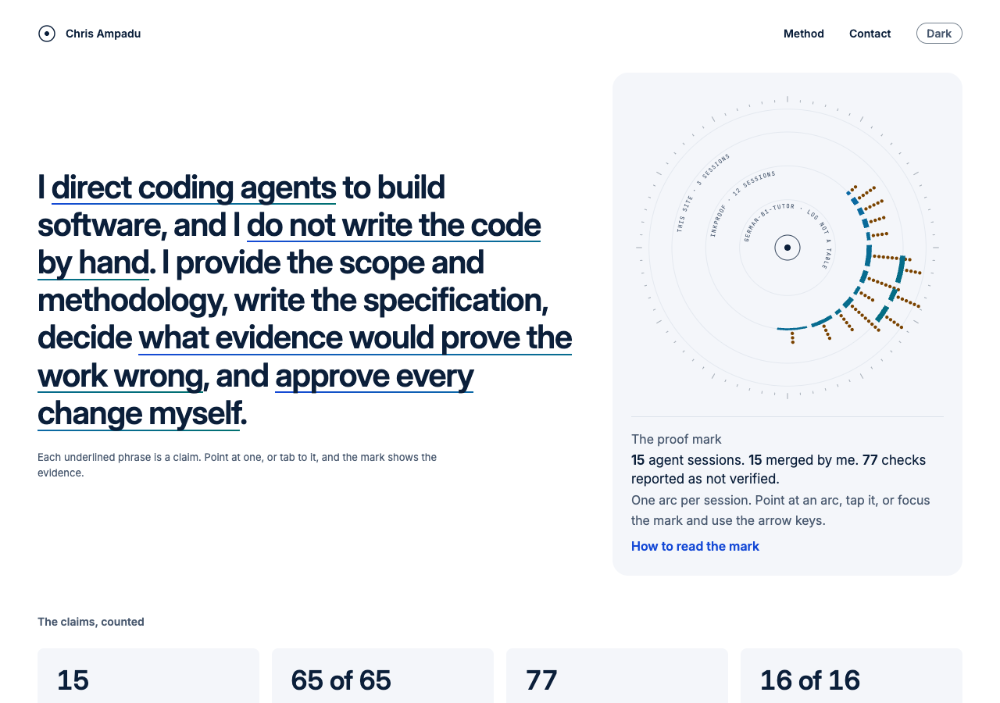
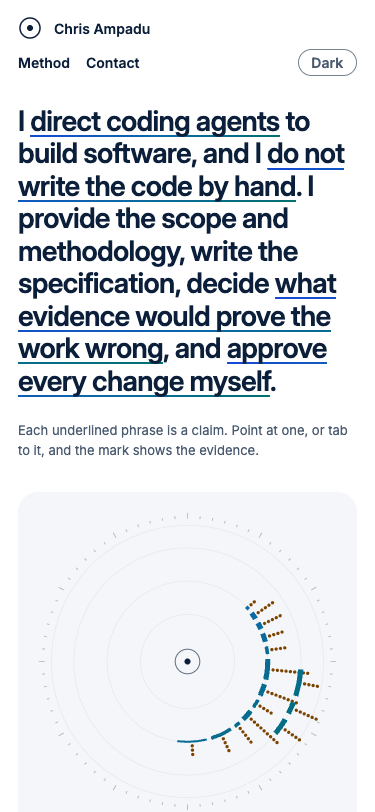

# ampaduchris.github.io

The personal site of Chris Ampadu. It states one claim: I direct coding agents and approve every change, and I do not write the code by hand. Every number on it is meant to be checkable from a public source.

Built by directing Claude Code. No hand-written code. Every pull request was opened by the agent and approved and merged by me. Model and effort for every session are recorded in docs/BUILD-LOG.md.

Status: released, dependencies reviewed monthly.

## Demo

The live site is the demo: https://ampaduchris.github.io

Two screenshots of Home, taken by Playwright with `npm run screenshots`. CI runs the same script on every pull request to prove it still works, and discards the output.





## What it is

A static site built with Astro and TypeScript: Home, Method, Contact, Legal, a not-found page, and two short paths, `/cv/` and `/in/`, that show Home's content with a canonical link to Home and no indexing. The Method page and the proof mark compute every number from public build logs and pull request records. A workflow deploys `dist/` to GitHub Pages from `main` only, after the checks pass. The build fails while the legal text is missing or pending.

The authority for behaviour is `docs/spec.md`. Requirements carry `REQ-###` and MUST or SHOULD, and `scripts/trace.py` fails CI when a MUST has no test. Version 1.0.0 is the first release; see `CHANGELOG.md`.

## Verify it yourself

Set up once, with Node 24 or 26 and the GitHub command line (`gh`) logged in:

```bash
git clone https://github.com/ampaduchris/ampaduchris.github.io && cd ampaduchris.github.io && npm ci
```

The numbers on the Method page are computed from public build logs and pull request records. Three commands rebuild them and compare them with the committed file. CI runs the second command against the recorded snapshot on every pull request. The first command needs the network and is not run in CI; the third is a plain `git diff`.

```bash
npm run numbers -- --live
```

```bash
npm run numbers -- --from-snapshot --check
```

```bash
git diff --stat -- src/data/method.json
```

The first command fetches the sources again and overwrites `src/data/snapshot.json` and the three output files. The third shows what changed. A difference is expected when the owner has opened or merged pull requests since `generated_at`. The time stamp is the only difference when nothing has happened.

To run the checks that CI runs:

```bash
npm run check && npm test && npm run build && npm run build:fixture && npm run e2e
```

The last step runs the browser tests, including the axe accessibility check on every route in both colour schemes and at two widths. Locally it uses an installed Google Chrome. In CI it uses Chromium.

## Limits

- The Method page shows no median until 20 pull requests exist.
- The numbers are as of `generated_at`, not live. The agent and the owner share one GitHub account, so the comment and merge figures cannot tell who wrote a comment.
- Analytics is off. `site.yml` has no endpoint and the repository holds no counting script.
- Project data in `src/data/projects.yml` is checked against each project repository by `npm run sync-check`, which needs the network. A weekly workflow runs it and opens an issue on a difference. It is not part of the pull request checks. `german-b1-tutor` has no `portfolio.yml` until its pull request 40 merges, and the check reports that.
- Link checking in pull requests is offline and covers internal links only. A weekly workflow checks external links.
- Mutation testing (Stryker) runs by hand, not in CI, on the numbers script, the data schema check and the mark layout. The score and every surviving mutant are in `docs/MUTATION.md`. The schema check is untested for most invalid values.
- Lighthouse is reported, not gated. There is no social preview image.
- Firefox and WebKit tests run in CI but are not required checks.

## Disclosure

The code here was generated by Claude Code under my direction. I wrote the requirements and approved each change. The law on copyright in machine-generated code is unsettled. I license whatever rights I hold under the licence in this repository.

The licence is MIT. See `LICENSE`.
